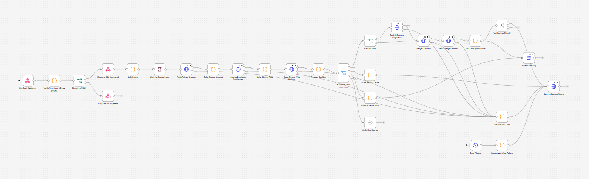
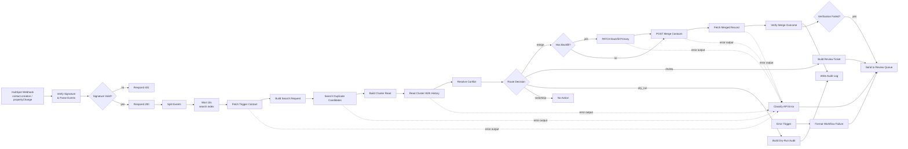

# n8n-hubspot-contact-merge-conflict-resolver

A webhook-driven deduplication sentinel for HubSpot, built on n8n. It catches contact creation and identity-change events, finds conflicting records, scores them on property completeness and recency, and applies strict precedence rules. It then backfills the surviving record, merges through the HubSpot Contacts API and checks the result. Anything ambiguous goes to a human review queue, not to an automatic merge.

  

---

## Contents

- [Design principles](#design-principles)
- [Architecture](#architecture)
- [Repository layout](#repository-layout)
- [Setup](#setup)
- [Node configuration reference](#node-configuration-reference)
- [Matching rules](#matching-rules)
- [Merge precedence matrix](#merge-precedence-matrix)
- [Decision outcomes](#decision-outcomes)
- [Error handling and fallback routing](#error-handling-and-fallback-routing)
- [Testing](#testing)
- [Go-live checklist](#go-live-checklist)
- [Operational notes and limitations](#operational-notes-and-limitations)
- [Disclaimer](#️-disclaimer--liability-limitation)
- [License](#license)

---

## Design principles

1. **Safe by default.** The workflow ships with `DRY_RUN=true` and `SANDBOX_MODE=true`. It plans merges and logs them, but writes nothing until you switch it on.
2. **Only exact matches auto-merge.** Only a canonical email match merges automatically. Phone and name matches go to review.
3. **No silent data loss.** Before merging, the secondary's values are written onto the primary under explicit rules, and every overwritten value is recorded in the audit log.
4. **Allowlisted writes only.** The resolver can write only the properties named in the rules. Identity, ownership, consent, lifecycle and system properties are never written. A misconfiguration that tries to write one throws an error and stops the run.
5. **Deterministic.** Two runs on the same pair always choose the same primary, so concurrent webhook deliveries can't merge in opposite directions.
6. **Verify, don't assume.** After a merge, the workflow reads the merged record back and raises a ticket if it doesn't hold the planned values.
7. **One source of truth for logic.** Every Code node is generated from `src/`, the same code the Jest suite tests.

---

## Architecture





**How a request flows**

1. **Ingest and authenticate.** The Webhook node keeps the raw body, so the `X-HubSpot-Signature-v3` HMAC can be checked byte for byte, along with the 5-minute timestamp window. HubSpot gets a 200 within milliseconds, well inside its timeout, and the slow work runs afterwards.
2. **Filter.** The batch, up to 100 events, is filtered: wrong portal, unsupported subscription, unwatched property, events caused by this app (loop prevention), and repeated events for the same contact, where only the newest is kept.
3. **Wait.** HubSpot CRM search is eventually consistent, so a newly created contact may not be searchable straight away. A 10-second wait avoids false "no duplicate" results.
4. **Recall.** The trigger contact is fetched, and a search with up to 5 OR filter groups (canonical email, first + last name, phone/mobile) collects candidates, excluding the trigger itself.
5. **Precision.** The trigger and its candidates are batch-read with `propertiesWithHistory` for the recency-ruled properties. `Resolve Conflict` then applies the matching tiers, scoring, precedence and backfill rules.
6. **Act.** The workflow merges, sends a review ticket, logs a dry run, or does nothing.
7. **Verify and audit.** The merged record is read back and compared with the plan. Every merge and dry run is logged.

---

## Repository layout

```text
n8n-hubspot-contact-merge-conflict-resolver/
├── workflow.json                 # n8n import file (generated, do not hand-edit Code nodes)
├── src/
│   ├── conflict-resolver.js      # matching, scoring, precedence, backfill, decisions, tickets
│   ├── hubspot-signature.js      # X-HubSpot-Signature-v3 verification
│   └── event-filter.js           # webhook batch filtering and deduplication
├── scripts/
│   ├── build-workflow.js         # embeds src/ into workflow.json (also --check)
│   └── send-test-webhook.js      # sends a signed test batch to a staging n8n instance
├── test/
│   ├── conflict-resolver.test.js # unit tests: scoring, recency, matching, payloads, signature
│   ├── workflow.test.js          # workflow integrity: sync, wiring, retries, no secrets
│   └── fixtures/hubspot-webhook-batch.json
├── .env.example
├── .gitignore
├── package.json
├── DISCLAIMER.md
└── LICENSE
```

---

## Setup

### Prerequisites

- n8n 1.x, self-hosted or cloud, with access to environment variables
- A HubSpot **developer test account** or sandbox for staging
- Node.js 18+ for running tests and helper scripts locally

### 1. Create the HubSpot app

1. In your **test** HubSpot account, create a private app (or use a public app you control).
2. Grant these scopes: `crm.objects.contacts.read` and `crm.objects.contacts.write`.
3. Note the **access token**, the **client secret** and the **app ID**. Store them in your secret manager. Never put them in this repo.
4. Under the app's **Webhooks** settings:
   - Target URL: `https://your-n8n-webhook-domain.com/webhook/hubspot/contact-merge-resolver`
   - Subscriptions:
     - `contact.creation`
     - `contact.propertyChange` for `email`, `phone`, `mobilephone`, `firstname`, `lastname`

### 2. Configure the n8n host

Set every variable from `.env.example` in the n8n process environment (Docker `environment:`, systemd unit, or your cloud equivalent). Two n8n settings are required:

| Variable | Value | Why |
|---|---|---|
| `N8N_BLOCK_ENV_ACCESS_IN_NODE` | `false` | Code nodes and expressions read config from `$env` |
| `NODE_FUNCTION_ALLOW_BUILTIN` | `crypto` | Signature verification uses Node's `crypto` HMAC |

If your Code nodes run on external task runners, set the same variables on the runners too. Restart n8n after changing the environment.

### 3. Import and wire the workflow

1. In n8n, go to **Workflows → Import from File** and choose `workflow.json`.
2. Create a credential of type **HubSpot App Token** containing your private app token. Select it on these six nodes: `Fetch Trigger Contact`, `Search Duplicate Candidates`, `Read Cluster With History`, `Backfill Primary Properties`, `Merge Contacts`, `Fetch Merged Record`.
3. Go to **Workflow Settings → Error workflow** and select this same workflow. This lets the `Error Trigger` node catch unhandled failures.
4. Save. The workflow imports **inactive**. Activate it only after the testing steps below.

### 4. Review queue and audit log endpoints

`REVIEW_QUEUE_WEBHOOK_URL` and `AUDIT_LOG_WEBHOOK_URL` receive JSON via POST. Point them at a Slack incoming webhook, a ticketing intake endpoint, a sheet-append webhook, or another n8n workflow that writes to your store of choice. Both can be the same endpoint, since every payload carries a `type` field (`merge_audit`, `merge_review`, `merge_verification_mismatch`, `api_error`, `workflow_failure`).

---

## Node configuration reference

| # | Node | Type | Key configuration |
|---|---|---|---|
| 1 | HubSpot Webhook | Webhook v2 | `POST`, path `hubspot/contact-merge-resolver`, response mode **Using 'Respond to Webhook' node**, option **Raw Body = on** |
| 2 | Verify Signature & Parse Events | Code | HMAC-SHA256 v3 check against `WEBHOOK_PUBLIC_URL` + raw body + timestamp; max age `SIGNATURE_MAX_AGE_MS`; event filter |
| 3 | Signature Valid? | IF v2 | `$json.valid` is true |
| 4 | Respond 200 Accepted / Respond 401 Rejected | Respond to Webhook | JSON body with accepted/skipped counts or the rejection reason |
| 5 | Split Events | Code | One item per contact event; adds the property list to read |
| 6 | Wait for Search Index | Wait | 10 seconds (raise to 20–30s in busy portals) |
| 7 | Fetch Trigger Contact | HTTP Request | `GET /crm/v3/objects/contacts/{id}?properties=…&archived=false` |
| 8 | Build Search Request | Code | Builds OR filter groups, excludes self via `hs_object_id NEQ` |
| 9 | Search Duplicate Candidates | HTTP Request | `POST /crm/v3/objects/contacts/search`, limit `MAX_CANDIDATES` |
| 10 | Build Cluster Read | Code | Trigger + candidate IDs, `propertiesWithHistory` for recency properties |
| 11 | Read Cluster With History | HTTP Request | `POST /crm/v3/objects/contacts/batch/read` |
| 12 | Resolve Conflict | Code | Matching tiers, scoring, precedence, backfill plan, decision |
| 13 | Route Decision | Switch v3 | Outputs: `merge`, `review`, `dry_run`, fallback `none_or_skip` |
| 14 | Has Backfill? | IF v2 | `$json.decision.hasBackfill` |
| 15 | Backfill Primary Properties | HTTP Request | `PATCH /crm/v3/objects/contacts/{primaryId}` with allowlisted properties only |
| 16 | Merge Contacts | HTTP Request | `POST /crm/v3/objects/contacts/merge` with `{ "primaryObjectId", "objectIdToMerge" }` |
| 17 | Fetch Merged Record | HTTP Request | `GET /crm/v3/objects/contacts/{mergedId}` for the planned properties |
| 18 | Verify Merge Outcome | Code | Compares the planned values with actual values; builds the audit entry and a mismatch ticket if needed |
| 19 | Write Audit Log / Send to Review Queue | HTTP Request | `POST` JSON to `AUDIT_LOG_WEBHOOK_URL` / `REVIEW_QUEUE_WEBHOOK_URL` |
| 20 | Classify API Error | Code | Turns HubSpot API failures into graded tickets |
| 21 | Error Trigger → Format Workflow Failure | Error Trigger + Code | Catches unhandled exceptions as critical tickets |

All six HubSpot nodes use **Retry on Fail** (3 tries, 3s apart) for transient 429/5xx errors, and **On Error → Continue (using error output)** so failures reach the classifier rather than being lost.

### Environment variables

| Variable | Default | Purpose |
|---|---|---|
| `DRY_RUN` | `true` | Plan and log only; no PATCH or merge |
| `SANDBOX_MODE` | `true` | Marks audit entries as sandbox; required for skipping the signature check |
| `HUBSPOT_CLIENT_SECRET` | — | Signature verification secret |
| `HUBSPOT_APP_ID` | — | Ignore events this app causes (loop guard) |
| `EXPECTED_PORTAL_ID` | — | Reject events from any other HubSpot portal |
| `WEBHOOK_PUBLIC_URL` | — | Exact public URL HubSpot signs, including any query string |
| `HUBSPOT_SKIP_SIGNATURE_CHECK` | `false` | Local testing only; ignored unless `SANDBOX_MODE=true` |
| `SIGNATURE_MAX_AGE_MS` | `300000` | Replay window (60,000–600,000) |
| `MAX_CANDIDATES` | `10` | Above this many search hits, send to review (1–50) |
| `HUBSPOT_API_BASE_URL` | `https://api.hubapi.com` | Override for a mock server during testing |
| `REVIEW_QUEUE_WEBHOOK_URL` | — | Review tickets and error tickets |
| `AUDIT_LOG_WEBHOOK_URL` | — | Merge and dry-run audit entries |

---

## Matching rules

The search step aims for **recall**. Match tiers decide **precision**.

| Tier | Signals | Result |
|---|---|---|
| **Exact** | Same canonical email: lowercased, plus-tag removed, Gmail dots removed, `googlemail.com` treated as `gmail.com`. Also counts if one record's email appears in the other's `hs_additional_emails` | Eligible for **auto-merge** |
| **Probable** | Phone/mobile (last 10 digits) + same last name, **or** same first + last name + same company (legal suffixes removed) or same non-freemail email domain | **Review only** |
| **Downgraded** | Exact email but different first/last names, or a role address (`info@`, `sales@`, `support@` and similar) | **Review only** |
| **None** | Anything else | Ignored |

---

## Merge precedence matrix

### 1. Primary record retention

The primary is the record that survives the merge. It is chosen by these rules, in order; the first rule that separates the records decides.

| Rank | Criterion | Direction |
|---|---|---|
| 1 | Completeness score (weighted, 0–100) | Highest wins |
| 2 | `lastmodifieddate` | Most recent wins |
| 3 | `createdate` | Oldest wins |
| 4 | Record ID | Lowest wins (deterministic tie-break) |

**Completeness weights** (sum = 100): `email` 20 · `firstname` 10 · `lastname` 10 · `phone` 10 · `company` 10 · `mobilephone` 5 · `jobtitle` 5 · `website` 5 · `lifecyclestage` 5 · `hubspot_owner_id` 5 · `address`/`city`/`state`/`zip`/`country` 3 each.

### 2. Property-level rules (secondary backfill)

| Class | Properties | Rule |
|---|---|---|
| **Fill-empty** | `firstname`, `lastname`, `website` | Primary keeps its value. The secondary's value is copied only if the primary's is empty |
| **Atomic group** | `address`, `city`, `state`, `zip`, `country` | Copied as a set, and only when **all** of the primary's address fields are empty, so addresses are never mixed |
| **Recency-wins** | `phone`, `mobilephone`, `company`, `jobtitle` | The value with the newest timestamp in `propertiesWithHistory` wins (falls back to `lastmodifieddate`). Ties go to the primary. Formatting-only differences are ignored. The overwritten value is logged as `previousValue` |
| **Conflict → review** | `hubspot_owner_id`, `hs_email_optout` | If the records hold different non-empty values, nothing merges and a review ticket is created |
| **Never written** | `email`, `hs_additional_emails`, `lifecyclestage`, `hs_lead_status`, `hubspot_owner_id`, `hs_email_optout`, `createdate`, `lastmodifieddate`, `hs_object_id`, `hs_merged_object_ids` | Left to HubSpot's native merge behaviour. The secondary's email is kept by HubSpot as an additional email |

The backfill is applied with a `PATCH` to the primary **before** the merge. The chosen values are then both present on the primary and its most recent writes. That makes the outcome predictable under HubSpot's own merge rules, and the post-merge check confirms it.

To change the rules, edit `defaultConfig()` in `src/conflict-resolver.js`, then run `npm test && npm run build:workflow`.

---

## Decision outcomes

| Action | When | What happens |
|---|---|---|
| `merge` | One exact match, no protected conflict, `DRY_RUN=false` | Backfill PATCH (if needed) → merge → verify → audit |
| `dry_run` | Same as `merge` but `DRY_RUN=true` | Full plan written to the audit log; HubSpot untouched |
| `review` | Probable match, more than one duplicate, too many candidates, or owner/opt-out conflict | Ticket with matches, scores, conflicts and suggested primary |
| `none` | Candidates found, none actually match | Nothing |
| `skip` | Trigger already merged, archived or deleted | Nothing |

**Sample `dry_run` audit entry** (dummy data):

```json
{
  "type": "merge_audit",
  "outcome": "dry_run",
  "portalId": "1234567",
  "eventId": "5001",
  "triggerObjectId": "1002",
  "primaryId": "1001",
  "secondaryId": "1002",
  "backfill": {
    "properties": { "jobtitle": "Director" },
    "decisions": [
      { "property": "jobtitle", "rule": "newer_value_wins", "sourceId": "1002",
        "previousValue": "Analyst", "timestampBasis": "property_history" }
    ]
  },
  "scores": [
    { "id": "1001", "score": 100, "lastmodifieddate": "2025-06-01T00:00:00Z", "createdate": "2025-06-01T00:00:00Z" },
    { "id": "1002", "score": 35, "lastmodifieddate": "2026-01-10T00:00:00Z", "createdate": "2025-06-01T00:00:00Z" }
  ],
  "matches": [{ "id": "1001", "tier": "exact", "signals": ["email_match"] }],
  "reasons": ["exact_match_safe_to_merge"],
  "dryRun": true,
  "sandboxMode": true
}
```

---

## Error handling and fallback routing

| Situation | Handling | Severity |
|---|---|---|
| Bad, stale or missing signature | `401` to the caller, nothing processed | — |
| `404` fetching the trigger contact | Ignored: contact deleted or already merged | — |
| `401`/`403` from HubSpot | Ticket `auth_or_scope` | critical |
| `429` after retries | Ticket `rate_limited` | high |
| `5xx` after retries | Ticket `hubspot_unavailable` | high |
| Merge `404`/`409` | Ticket `possible_concurrent_merge`; notes whether the backfill was already applied | low |
| Backfill fails | Merge is **not** attempted; ticket raised | high |
| Merged record doesn't match the plan | Ticket `merge_verification_mismatch` listing each mismatch | high |
| Unhandled exception anywhere | `Error Trigger` → `workflow_failure` ticket | critical |

Audit and review-queue posts retry 3 times and never fail the run.

---

## Testing

### Unit and integrity tests

```bash
npm install
npm test               # 100+ Jest tests
npm run test:coverage  # with coverage thresholds
npm run verify         # checks workflow.json matches src/, then runs tests
```

`test/conflict-resolver.test.js` covers:

- **Score calculations:** full, empty, partial and whitespace-only records
- **Recency comparisons:** property history vs `lastmodifieddate` fallback, ties favouring the primary, formatting-only phone differences
- **Precedence:** each of the four ranking rules, including order-independent tie-breaking
- **Matching tiers:** canonical email, additional emails, role addresses, name mismatch, phone + last name, name + company/domain, the freemail guard
- **Backfill:** fill-empty, newer-wins with `previousValue`, the atomic address group, owner conflicts, and refusal to write protected properties
- **Merge payload structure:** `{ primaryObjectId, objectIdToMerge }` as strings, with the correct direction
- **Decision routing:** merge / dry_run / review (each reason) / none / skip
- **Request builders:** search filter groups (≤5 groups, ≤6 filters each, excludes self), batch read with history
- **Verification, audit and tickets:** pass and mismatch cases, error classification by status and stage
- **Webhook security:** valid signature, tampered body, stale or future timestamp, placeholder secret, URI normalisation
- **Event filtering:** portal guard, loop guard, unwatched properties, deduplication within a batch

`test/workflow.test.js` checks that `workflow.json` matches `src/`, that every connection resolves, that every Code node compiles, that every HubSpot node has retry and an error output, and that no tokens or non-dummy emails are present.

### Staging end-to-end test

1. In your **HubSpot test account**, create two dummy contacts, for example `jordan@example.com` (fill in many fields) and `jordan+new@example.com` (sparse, with a newer `jobtitle`).
2. Keep `DRY_RUN=true` and `SANDBOX_MODE=true`, and set `EXPECTED_PORTAL_ID` to the test account's ID. Activate the workflow.
3. Create the second contact, or send a signed batch yourself:
   ```bash
   cp .env.example .env    # fill in staging values
   # edit test/fixtures/hubspot-webhook-batch.json: set objectId and portalId to your test values
   npm run send:test-webhook
   ```
4. Confirm a `dry_run` entry appears in the audit log with the expected primary, backfill and scores.
5. Repeat for the review paths: same phone + last name, two contacts with different owners, three-way duplicates.
6. Set `DRY_RUN=false`, repeat step 3, then confirm in HubSpot that the merged record holds the backfilled values and that the audit entry shows `"outcome": "merged"`.

---

## Go-live checklist

- [ ] Every test passes (`npm run verify`)
- [ ] At least a week of `dry_run` audit entries reviewed, with no decisions you disagree with
- [ ] `EXPECTED_PORTAL_ID` set to the production portal
- [ ] `HUBSPOT_SKIP_SIGNATURE_CHECK=false` and `SANDBOX_MODE=false`
- [ ] The review queue is monitored by a named owner
- [ ] Error workflow set to this workflow
- [ ] Run historical backfill deduplication separately; this sentinel only handles new events
- [ ] `DRY_RUN=false` switched on during a monitored window

---

## Operational notes and limitations

- **Treat merges as permanent.** Assume a merged contact can't be split back. Dry-run first.
- **One pair at a time.** The merge API is pairwise. Clusters of three or more go to review rather than chained merges.
- **Search lag.** Raise the wait time if `none` decisions show up for duplicates you know exist.
- **Phone search is exact-string.** HubSpot search compares the stored phone string, so differently formatted numbers can be missed at the recall step. The email and name groups usually catch those contacts anyway.
- **Rate limits.** Each event costs about 4–6 API calls, and CRM search has its own lower per-second limit. During large imports, consider pausing the workflow and running a batch dedupe afterwards.
- **Loop guard.** Events caused by this app are dropped using `HUBSPOT_APP_ID`. If HubSpot labels the source differently in your account, the workflow still converges: once the duplicates are merged, re-triggered runs find nothing to do.
- **Concurrency.** If both duplicates fire events at once, both runs pick the same primary, because ranking is deterministic. The second merge fails harmlessly and is logged as a low-severity `possible_concurrent_merge`.

---

## ⚠️ Disclaimer & Liability Limitation

**Use at your own risk.** The code, workflows, and scripts provided in this repository (`n8n-hubspot-contact-merge-conflict-resolver`) are for educational and architectural demonstration purposes.

* **No Liability:** The author and dhRobin Systems assume no responsibility or liability for any direct, indirect, incidental, or consequential damages resulting from the use, misuse, or deployment of these scripts.
* **No Warranty:** All software, n8n JSON blueprints, and JavaScript modules are provided "AS IS" without warranty of any kind, express or implied, including but not limited to merchantability, fitness for a particular purpose, or non-infringement.
* **Production Testing Required:** Always test thoroughly in an isolated staging environment (for example a HubSpot developer test account or sandbox) with `SANDBOX_MODE=true` and `DRY_RUN=true` enabled before connecting live HubSpot credentials. Treat every merge as irreversible.
* **Third-Party APIs & Compliance:** Users are solely responsible for complying with the terms of service, rate limits, data privacy regulations (GDPR/CCPA), and security policies of HubSpot and any connected services. That includes confirming a lawful basis for combining records, honouring the consent and subscription preferences of every merged record, and reviewing every automated merge and property overwrite.

The full disclaimer is also available in [DISCLAIMER.md](https://github.com/dhrobinsystems/n8n-hubspot-contact-merge-conflict-resolver/blob/main/DISCLAIMER.md).

## License

Released under the MIT License. Copyright (c) 2026 DH Robin (dhRobin Systems). See [LICENSE](https://github.com/dhrobinsystems/n8n-hubspot-contact-merge-conflict-resolver/blob/main/LICENSE).
